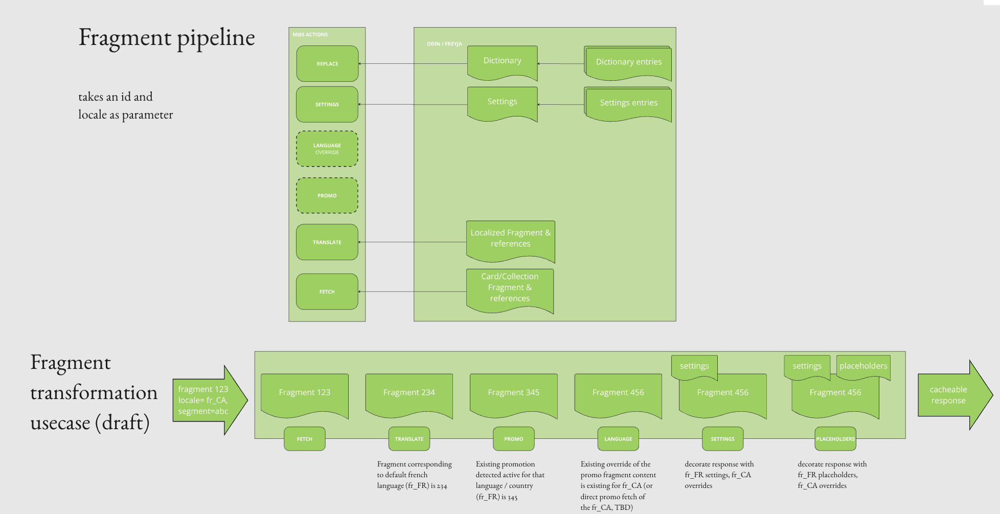
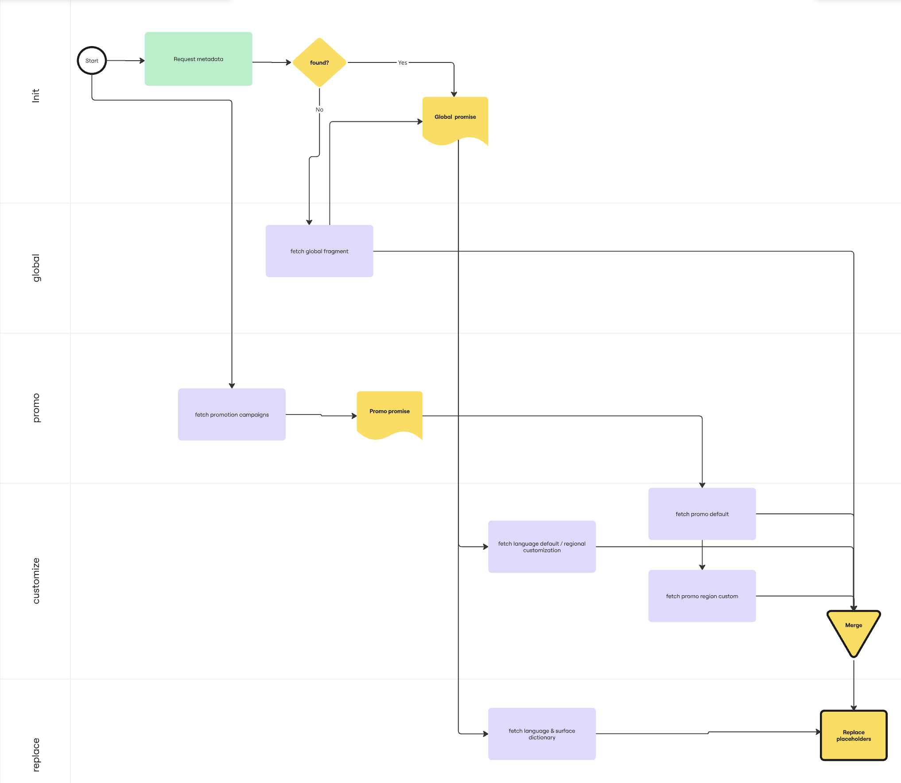
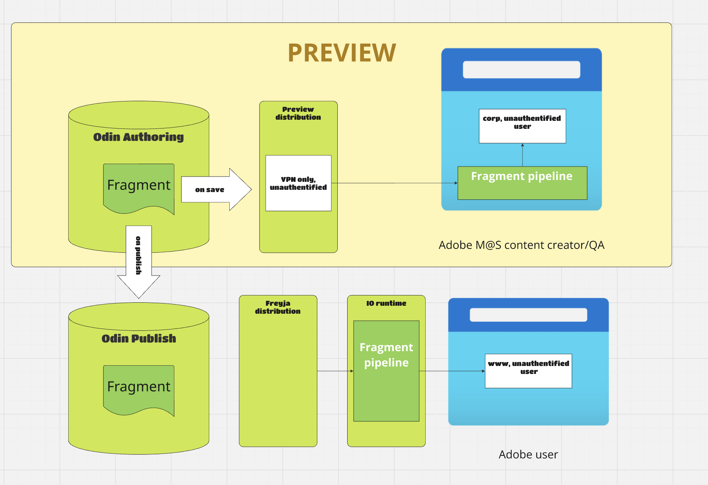

# fragment pipeline

this action sits behind mas/io/fragment in CDN and treats multiple odin related requests to provide m@s customers with :

- placeholders,
- settings,
- promotion,
- masks (field overlays applied on top of card fragments),
- regional and personalization customization,

that each stand behind so called transformers. To optimize calls make to odin, the sequence is based on promises created at init time and sometimes depending on each other. The pipeline order is:

`fetchFragment → defaultLanguage → offer → promotions → mask → customize → settings → replace → wcs → corrector`

You can see the full flow on below diagram:

## offer baselines (MWPW-186204)

Request parameters: `locale` (required), `id`, `offer` (an OSI for now), `template` (a card variant), `surface`.

Surface resolution: the `surface` parameter is the source of truth, then the surface of the `id` fragment, then the api key's (`apiKeySurfaces` configuration). A `surface` parameter different from the api key's or the fragment's surface returns `404`.

- with `id`: the `offer` transformer looks baselines up for the requested fragment and for every card of its references tree (collections). Each fragment's offer (the `offer` param for the root, its own `osi` otherwise) is resolved through WCS to its product arrangement code, its template is its `variant` (or the `template` param for the root). `customize` then layers, per fragment: offer baseline < fragment baseline < fragment < its variations. A fragment baseline can hold the content common to all cards of an offer & template. Failures are logged and ignored.
- without `id`: `offer`, `template` & a surface (parameter or api key's) are required (400 otherwise). The main body is the fragment baseline, or the offer baseline when there is no fragment baseline (404 if there is neither).

Baselines locations (`<pa>` being the product arrangement code, e.g. `phsp_direct_individual`):

- offer baseline (offer model, MCS copy & assets): `/content/dam/mas/offers/<locale>/<pa>/baseline`, falling back to `en_US`. With ~1800 product arrangements per locale in MCS, that folder is too big to list per request: the `offers` action (every 15 minutes) syncs it into the namespace state, one `offer-<locale>-<pa>` key each (only changed ones are written, removed ones deleted), and the pipeline reads the keys it needs,
- fragment baseline: `/content/dam/mas/<surface>/<locale>/baselines/<template>/<pa>`.

Baselines are fields only: their references are not hydrated.

Baselines' own variations are ignored. Each customized fragment exposes `offerBaselineId` / `fragmentBaselineId`, and the root `fields.osi` is forced to the `offer` param.

Nothing is requested twice, whatever the collection size: distinct offers are resolved in one WCS batch whose artifacts are reused by the `wcs` transformer (and always shipped in `body.wcs`). Fragment baselines are fetched in bulk, in parallel with WCS, with one (paginated) listing of `/content/dam/mas/<surface>/<locale>/baselines/<template>` per template used; offer baselines are read from state, one key per product arrangement used. Both are kept in a single-flight SWR cache (5 min TTL) shared by all fragments and requests, absence included.

## configuration

you can configure a few things via state with `aio app state put/del` command
to see all configuration in place, type `aio app state list`

workspace wise configurations are put in one single key named `configuration`
please don't forget that every state item has TTL defaulting to 24h! typical long live TTL to add to your command would be `--ttl=31536000`

below are the members of that object
| Configuration Key | Description | Type | Default |
| -------------------- | --------------------------------------------------------------------------------------------------------------------------------------------------------------------------------------------------------------------------------------------------------------------------------------------------------------------------------------------------------------------------------------------------------- | ------- | ------- |
| `wcsConfiguration` | WCS (Web Content Service) endpoints, one per environment, e.g. `[{"wcsURL":"https://www.stage.adobe.com/web_commerce_artifact","env":"stage"}]`. The `prod` row is hardcoded in `utils/configuration.js`; you only need to list extra envs here. A state entry with `env: "prod"` overrides the hardcoded URL (handy for dev/test workspaces). | Array | ``    |
| `apiKeys`           | Extra accepted client API keys, merged with the hardcoded baseline in `utils/configuration.js`. Entries are literal strings; wrap a value in `/.../` to match a regex pattern, e.g. `["my-test-key", "/^CreativeCloud_v\\d+_\\d+$/"]`. Unknown api_key values in the request → `401` before any downstream call. | Array |`` |
| `apiKeySurfaces` | Surface served by an api key, e.g. `{"AdobeExpressWeb": "express", "/^CreativeCloud_v\\d+_\\d+$/": "ccd"}` (keys accept the same `/.../` regex form as `apiKeys`). Used as surface when the request has neither `surface` nor `id`; a `surface` parameter conflicting with it → `404`. | Object |`` |
| `debugLogs` | turns debug log on | Boolean | `false` |
| `networkConfig` | Sets of threshold for timing out main process (`mainTimeout`) & subsequent fetches (`fetchTimeout`), e.g. `{"fetchTimeout":2000,"mainTimeout":15000,"retries":3,"retryDelay":500` | Array |`` |

Each configuration can be managed using the following commands:
https://wiki.corp.adobe.com/pages/viewpage.action?pageId=3587728545

### prod

In prod main timeout is 15seconds, it includes time that action takes to fetch `networkConfig`. Main timeout is from start of the action till end of execution.
Fetch timeout is 2seconds and applied to each fetch call separately. There are multiple fetch calls to Odin and WCS. WCS ones could be disabled.

## preview

[fragment-client.js](../fragment-client.js) is built consistently with what is deployed in adobe io runtime with
`npm run build:client` to reproduce that pipeline not in io runtime containers but on the browser.
