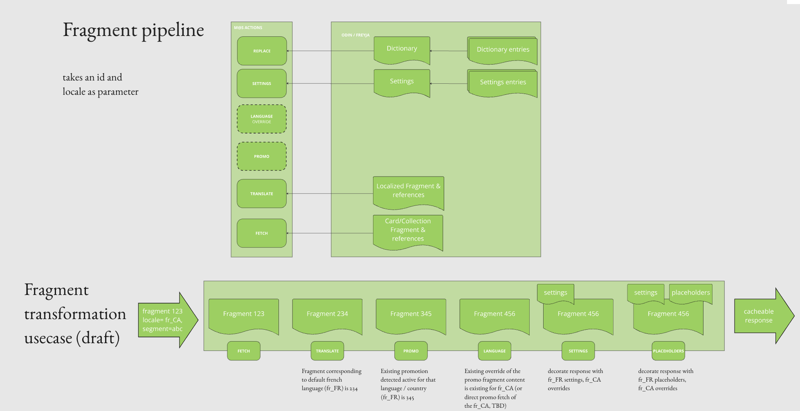
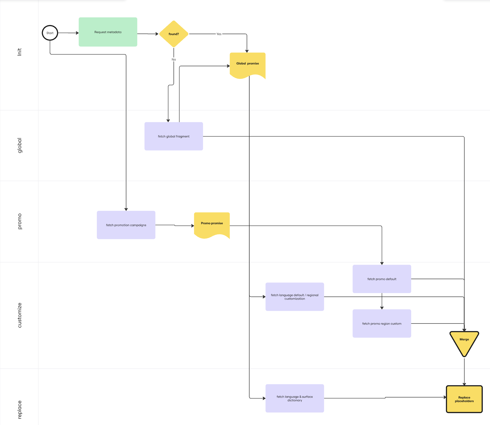
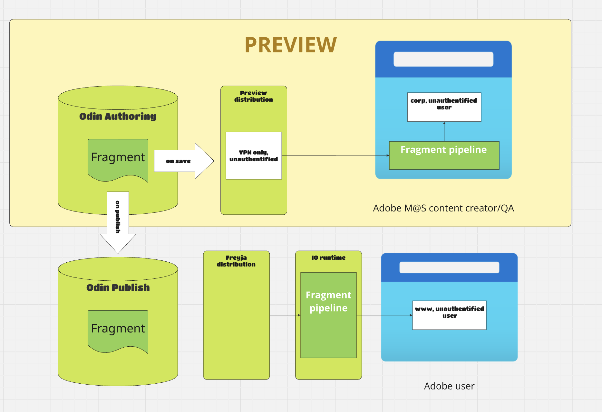

# fragment pipeline



This action sits behind `mas/io/fragment` in the CDN and serves M@S fragments with their placeholders, settings, promotions, masks, regional and personalization variations and baselines. Each of these is a transformer; to limit Odin calls, transformers create promises at init time, some depending on others. The pipeline order is:

`fetchFragment → defaultLanguage → offer → promotions → mask → customize → settings → replace → wcs → corrector → serialize`



Contracts:

- API (request parameters, api keys, surface resolution, response types): [DLV-0002](../../../../docs/decisions/delivery/DLV-0002-define-the-fragment-api-contract.md)
- caches, from the CDN to the stored responses: [DLV-0001](../../../../docs/decisions/delivery/DLV-0001-layer-caches-from-edge-to-origins.md)
- content layout: [CONT-0001](../../../../docs/decisions/content/CONT-0001-organize-content-by-surface-and-locale.md), variations: [CONT-0006](../../../../docs/decisions/content/CONT-0006-select-one-fragment-variation.md), promotions: [CONT-0003](../../../../docs/decisions/content/CONT-0003-model-promotions-as-projects-and-variations.md), baselines: [CONT-0005](../../../../docs/decisions/content/CONT-0005-layer-merch-content-through-baselines.md)

## offer baselines

Implementation details on top of [CONT-0005](../../../../docs/decisions/content/CONT-0005-layer-merch-content-through-baselines.md):

- with `id`, baselines are opt-in: only when the requested card or collection has `enableBaselines` on (toggled in Studio's General info), which then applies to every card it references. Failures are logged and ignored.
- without `id`, the response is the most specific baseline of `offer` and `template` (`404` if none). In both cases the root `fields.osi` is forced to the `offer` parameter.
- icons and their alt text: a layer setting its own icons (`mnemonicIcon`) drops the icons and alt text (`mnemonicAlt`) of every lower layer (baseline, fragment, variation or mask), while it can still override the alt text alone. Cleared icons (`['']`) count as setting icons for variations and masks, not over baselines. On cards without baselines, a variation or mask changing the icon keeps the card alt text.
- offer baselines are synced by the `offers` action into the namespace state, and fetched per locale (en_US fallback included) from `https://www.adobe.com/mas/io/offers?api_key=…&locale=<locale>&id` (the bare `id` is only there for the CDN to accept the request until WPS-36294).
- nothing is requested twice: distinct offers are resolved in one WCS batch reused by the `wcs` transformer (and shipped in `body.wcs`); fragment baselines are fetched with one paginated listing per template, in parallel with WCS. Both are kept in a single-flight SWR cache (5 min TTL), absence included.

## Inactive price-render transformer

`transformers/render.js` is available for direct execution only. It is **not**
registered in the pipeline, and does not change production responses or fetch
offers. It imports the shared framework-free implementation directly from
`price/src/price.js` and `price/src/offers.js` via relative paths, following the server's existing
cross-directory import convention. No installed price package or workspace
symlink is required; keep the repository's `price/src/` directory alongside
`io/www` when running or bundling the server. `parse5` remains a runtime dependency.

```js
import { transformer as render } from './transformers/render.js';

await render.process(context, {
    environment: 'prod', // Required; no default or cross-environment fallback.
    resolveOptions: ({ context, fragment, fieldName, valueIndex, attributes }) => {
        // The caller supplies already-resolved options for this particular price.
        return {
            country: 'US',
            language: 'en',
            wcsOsi: ['resolved-osi'],
            promotionCodes: [''],
            promotionCode: '',
            displayTax: false,
            forceTaxExclusive: false,
            quantity: [1],
            template: 'price',
            literals: {},
        };
    },
});
```

`resolveOptions` may be asynchronous. It receives decoded HTML attributes and
the owning fragment, field name, optional array index, and original context.
It must not mutate those inputs. Return the country used for the WCS cache
(including any commerce-country override), the display language, a non-empty
array of final OSIs, and an equally sized array of effective promotion codes.
Resolve substitutions, fragment/element promotion precedence, broadcast codes,
and `cancel-context` upstream; cancelled/non-promoted OSIs use `''`. The stage
does not reinterpret authored promo scope or fetch missing cache entries.

`promotionCodes` selects the cached offers separately for each OSI.
The singular `promotionCode` is the resolved per-placeholder selector passed to
the shared formatter: supply the resolved code for promotional rendering, or
explicitly supply `''` to disable it. Both inputs are required, including for
non-promotional prices. The caller resolves the selector using the browser's
precedence; the stage does not derive it from the first, joined, or non-empty
bundle cache codes. Unresolved `cancel-context` is rejected in either input.

`country`, `language`, `wcsOsi`, `promotionCodes`, `promotionCode`, `displayTax`, and
`forceTaxExclusive` must be supplied. Inputs are normalized rendering options,
not raw dataset strings: notably `forceTaxExclusive` must be a boolean.
Supply applicable literals, per-unit/annual/old-price flags, quantity and time
inputs, retaining the browser's override precedence. Optional formatting defaults
remain those of the shared package. Literal dictionary tokens must be resolved
or omitted; unresolved `price-literal-*` values are rejected. The stage does not
derive geo/segment tax policy, browser feature flags, provider defaults, or query
parameters. These are prerequisites for the separate activation ticket.

The selected cache is `context.body.wcs[environment]`. Cache keys follow the WCS
producer: final OSI, lowercased country, `mult` except for GB, then the lowercased
effective promotion code if present. Raw cached offers are copied and normalized
using `applyPlanType` imported from `price/src/offers.js` before offer
selection. Its mapping preserves the browser's existing tacocat behavior;
web-components is unchanged and continues using its current helper.
The server does not depend on Dexter or Pandora for normalization.
Missing environments/offers, empty offer groups, unaligned promotions,
and unresolved required options fail explicitly with request/field diagnostics.
All field updates are committed only after the entire render succeeds; cached
offers and unrelated context values are not modified.

For a `discount` template with exactly two OSIs, the first selected offer supplies
the discounted price and the second supplies the reference price, matching the
browser. Stale `priceInfo` is discarded on the derived offer. Other multi-OSI
prices retain shared soft-bundle summation; percentage calculation and markup
remain in the shared `price/src` implementation.

Root and flattened referenced fragments are processed once. String fields,
wrapped rich-text `value` strings/arrays and string-array fields are supported.
Only `<span is="inline-price">` contents are replaced. A source-offset HTML parser
preserves the original outer wrapper, attributes, spelling, whitespace and
surrounding markup; checkout links, badges and other content remain untouched.
Nested inline-price placeholders, prices inside inert `<template>` elements,
and wrappers without an explicit closing tag are rejected.

The original `is="inline-price"` and other client hooks remain on the wrapper.
The activation ticket must determine how to prevent unintended browser
re-rendering/hydration, supply the explicit environment and resolved option
provider, and then register the stage after `wcs` and before `corrector`.
No hidden activation flag or shadow rendering exists in this change.

Focused validation (Node 22+, from `io/www`):

```sh
npx mocha test/fragment/render.test.js
npm test
```

The tests use the unchanged shared golden corpus with fixed UTC time. Valid
fixtures assert exact price contents inside preserved wrappers. The shared
package's empty-offer/missing-option fixtures intentionally produce errors at
this transformer boundary, rather than blank prices.

## configuration

you can configure a few things via state with `aio app state put/del` command
to see all configuration in place, type `aio app state list`

workspace wise configurations are put in one single key named `configuration`
please don't forget that every state item has TTL defaulting to 24h! typical long live TTL to add to your command would be `--ttl=31536000`

below are the members of that object
| Configuration Key | Description | Type | Default |
| -------------------- | --------------------------------------------------------------------------------------------------------------------------------------------------------------------------------------------------------------------------------------------------------------------------------------------------------------------------------------------------------------------------------------------------------- | ------- | ------- |
| `wcsConfiguration` | WCS (Web Content Service) endpoints, one per environment, e.g. `[{"wcsURL":"https://www.stage.adobe.com/web_commerce_artifact","env":"stage"}]`. The `prod` row is hardcoded in `utils/configuration.js`; you only need to list extra envs here. A state entry with `env: "prod"` overrides the hardcoded URL (handy for dev/test workspaces). | Array | ``    |
| `apiKeys` | Extra accepted client api keys, literal or `/regex/`, e.g. `["my-test-key", "/^my_v\\d+$/"]`, see [DLV-0002](../../../../docs/decisions/delivery/DLV-0002-define-the-fragment-api-contract.md#api-keys). | Array |`` |
| `apiKeyDefaults` | Request parameter defaults per api key, e.g. `{"my-key": {"surface": "express", "type": "json"}}`, merged over the hardcoded `API_KEY_DEFAULTS`, see [DLV-0002](../../../../docs/decisions/delivery/DLV-0002-define-the-fragment-api-contract.md#api-keys). | Object |`` |
| `apiKeySurfaces` | Legacy, superseded by `apiKeyDefaults`: surface served by an api key, e.g. `{"my-key": "express"}`. | Object |`` |
| `debugLogs` | turns debug log on | Boolean | `false` |
| `networkConfig` | Sets of threshold for timing out main process (`mainTimeout`) & subsequent fetches (`fetchTimeout`), e.g. `{"fetchTimeout":2000,"mainTimeout":15000,"retries":3,"retryDelay":500`, as well as the CDN `cacheMaxAge` (300s), `cacheStaleWhileRevalidate` (86400s) and `staleCacheMaxAge` (30s, for `stale` responses, see [DLV-0001](../../../../docs/decisions/delivery/DLV-0001-layer-caches-from-edge-to-origins.md)) | Array |`` |

Each configuration can be managed using the following commands:
https://wiki.corp.adobe.com/pages/viewpage.action?pageId=3587728545

### prod

In prod main timeout is 15seconds, it includes time that action takes to fetch `networkConfig`. Main timeout is from start of the action till end of execution.
Fetch timeout is 2seconds and applied to each fetch call separately. There are multiple fetch calls to Odin and WCS. WCS ones could be disabled.

## preview



[fragment-client.js](../fragment-client.js) is built consistently with what is deployed in adobe io runtime with
`npm run build:client` to reproduce that pipeline not in io runtime containers but on the browser.
